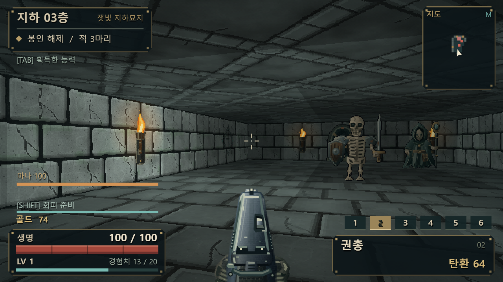
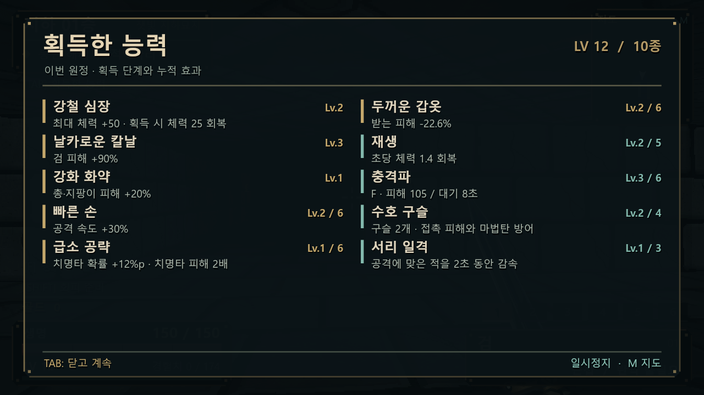
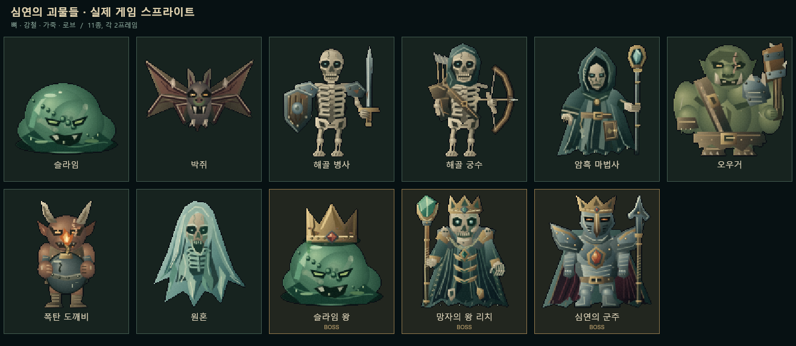
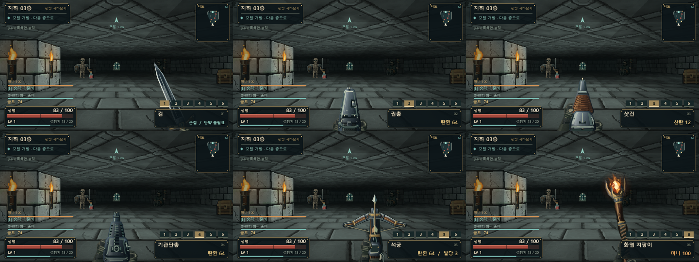

# 심연 강하 게임 기획서

버전 1.0 | 2026년 11월 15일

## 게임 개요

심연 강하는 검 한 자루로 시작해 무기와 능력을 모으며 지하 15층의 군주에게 도전하는 싱글플레이 1인칭 던전 액션 게임이다. 절차적으로 생성되는 공간에서 근접전, 사격, 회피를 교대하고, 원정 중의 능력 조합과 원정 밖의 영구 강화를 통해 반복 도전을 이어간다.

| 항목 | 기획 내용 |
| --- | --- |
| 장르 | 1인칭 로그라이크 액션, 영구 성장을 포함한 로그라이트 방식 |
| 플레이 환경 | PC 웹 브라우저, 키보드와 마우스, 싱글플레이 |
| 시각적 방향 | 다크 판타지 석조 던전과 고전 FPS의 중앙 무기 구도 |
| 기본 목표 | 15층 보스를 처치하고 포탈에 진입해 승리 |
| 확장 진행 | 승리 후 16층부터 무한 모드 계속 진행 |
| 현재 콘텐츠 | 무기 6종, 성장 선택지 19종, 일반 적 8종, 보스 3종, 환경 테마 5종 |
| 문서 구성 | 현재 게임의 규칙과 수치, 아트 방향, 검증 기록, 후속 개발 제안 |

주요 이용자는 짧은 조작 학습으로 전투에 진입하고, 무기 교대와 성장 선택을 반복해서 익히는 PC 액션 게임 이용자로 설정한다. 목표 플레이 시간과 적정 난이도는 후속 플레이테스트에서 확정한다.

<!-- pagebreak -->

## 핵심 경험과 플레이 흐름

### 설계의 중심

검은 탄약이 없을 때만 쓰는 보조 수단이 아니다. 적의 탄환을 베어 없애고, 검으로 처치했을 때 더 높은 확률로 탄약을 얻어 원거리 전투를 다시 준비하는 역할을 한다. 총은 안전한 거리에서 빠르게 공격하지만 자원을 소비하고 주변 적을 깨운다. 이동 경로와 무기 선택이 함께 생존을 결정한다.

능력 선택은 원정마다 다른 공격·생존 방식을 만든다. 사망이나 원정 포기 후에는 영혼을 영구 강화에 사용한다. 정보 확인은 전투를 멈춘 상태에서 할 수 있고, 저장 후 다음에 같은 원정을 계속할 수 있다.

### 한 번의 원정

| 단계 | 플레이어 행동과 결과 |
| --- | --- |
| 준비 | 새 원정 시작 또는 저장된 원정 이어하기. 영구 강화는 새 원정의 초기 상태에 반영 |
| 탐색 | 방과 통로를 이동하며 적, 상자, 상인, 포탈을 찾음 |
| 전투와 보급 | 검·총·석궁·지팡이를 교대하고 회복·탄약·골드를 수집 |
| 성장 | 경험치로 레벨 업. 최대 3개 후보 중 능력 1개를 획득하거나 강화 |
| 층 돌파 | 일반 층의 처치 조건 또는 보스 처치 조건을 달성한 뒤 포탈 사용 |
| 정산 또는 계속 | 사망·포기 시 영혼 정산. 15층 승리 후 종료하거나 무한 모드 선택 |

### 조작 체계

| 입력 | 기능 |
| --- | --- |
| W A S D / 마우스 | 이동 / 시점 회전 |
| 좌클릭 / 우클릭 | 현재 무기 공격 / 빠른 검 베기 후 원래 무기로 복귀 |
| Shift 또는 Space | 대시와 대시 중 무적 |
| 숫자 1~6 / 마우스 휠 / Q | 무기 선택 / 보유 무기 순환 |
| E / F | 상인·포탈 상호작용 / 획득한 충격파 사용 |
| Tab | 획득 능력 목록 열기·닫기. 열린 동안 전투 일시정지 |
| M | 전체 지도 열기·닫기. 열린 동안 전투 일시정지 |
| Esc | 일시정지 메뉴. 계속하기, 설정, 저장 후 나가기, 원정 포기 |

Tab과 M은 한 번 눌러 열고 다시 눌러 닫는다. 다른 정보창 키를 누르면 정지 상태를 유지하며 바로 전환한다. 정지 중 입력한 이동·발사·대시는 닫은 뒤에 실행되지 않는다.

<!-- pagebreak -->

## 던전 구조와 진행

### 공간 생성

맵은 46×46 격자이며, 방과 연결 통로를 절차적으로 만든다. 일반 방은 가로·세로 5~9칸, 보스 방은 11×11칸이다. 방 목표 수는 7 + 현재 층의 절반을 내림한 값이며 최대 12개다. 시작 방은 출구 방에서 이동 경로상 가장 먼 방으로 정한다.

각 층에는 상자 1개가 배치되고 45% 확률로 1개가 추가된다. 원거리 무기가 없는 1층에서는 첫 상자를 시작 방과 출구 방을 제외한 가장 가까운 방에 배치한다. 층을 이동해도 체력·탄약·마나가 자동으로 채워지지 않으므로 남은 자원을 고려해야 한다.

### 층별 테마와 보스

| 층 | 환경 테마 | 주요 진행 |
| --- | --- | --- |
| 1~3층 | 잿빛 지하묘지 | 슬라임·박쥐에서 시작해 해골·원거리 적으로 전투 확장 |
| 4~6층 | 핏빛 감옥 | 오우거 등장, 5층 슬라임 왕, 원혼 등장 |
| 7~9층 | 이끼 낀 유적 | 강한 적과 원거리 적의 출현 가중치 증가 |
| 10~12층 | 보랏빛 심연 | 10층 망자의 왕 리치 |
| 13~14층 | 잿빛 지하묘지 재등장 | 군주전 전 자원과 능력 조합 정비 |
| 15층 | 군주의 성소 | 심연의 군주 처치 후 포탈 진입으로 승리 |

일반 테마 4종은 3층 단위로 순환하고, 15의 배수 층에는 군주의 성소를 사용한다. 이후 보스는 20층 슬라임 왕, 25층 리치, 30층 군주 순으로 반복된다.

### 진행 조건

일반 층의 적 배치 수는 6 + 현재 층×2이며 최대 34마리다. 처음 배치된 적 수의 70%를 올림한 처치 목표를 달성하면 포탈이 열린다. 보스 층은 해당 일반 적 수의 40%를 올림해 배치하고 보스 1마리를 추가하며, 보스 처치가 포탈 개방 조건이다. 폭발통은 별도의 파괴 가능한 오브젝트다.

포탈은 열린 뒤 가까이 접근해 E로 사용한다. 15층 보스를 처치한 순간이 아니라 포탈에 들어갈 때 승리 화면으로 전환한다. 상인은 첫 15층 중 2·4·6·8·9·12·14층에 배치된다.

<!-- pagebreak -->

## 전투와 무기

수치는 영구 강화·원정 능력·치명타 적용 전 기본값이다. 발사 간격은 공격 속도 강화에 따라 짧아진다. 탄창과 수동 재장전 키는 없으며, 발사할 때 공유 자원에서 직접 차감한다.

| 무기 | 기본 피해 | 간격 | 소모 | 전술적 역할 |
| --- | --- | --- | --- | --- |
| 검 | 36 | 0.42초 | 없음 | 근접 범위 공격, 탄환 제거, 검 처치 보급 |
| 권총 | 21 | 0.28초 | 탄환 1 | 높은 탄약 효율의 정밀 사격 |
| 샷건 | 산탄당 10 × 7 | 0.80초 | 산탄 1 | 근거리 집중 피해. 모두 명중 시 기본 70 |
| 기관단총 | 12 | 0.10초 | 탄환 1 | 빠른 연속 공격, 권총보다 높은 탄약 소모 |
| 석궁 | 80 | 0.95초 | 탄환 3 | 관통 공격과 낮은 소음, 일렬의 적 대응 |
| 화염 지팡이 | 폭발 55 | 0.55초 | 마나 22 | 반경 2의 범위 공격, 마나 재생으로 유지 |

### 검과 회피

검은 기본 사거리 1.9이며, 앞쪽 범위 안의 적을 공격한다. 0.95초 안에 공격을 이어가면 3연타가 연결되고, 3타째는 피해 1.6배, 사거리 1.15배, 공격 범위 1.3배가 된다. 강한 3타의 공격 간격은 기본의 1.3배다. 범위 안의 적 탄환은 삭제되며 반사탄이 되지는 않는다.

우클릭 검 베기는 현재 공격 대기시간이 끝났을 때 사용할 수 있고, 약 0.42초 후 원래 무기로 돌아간다. 대시는 0.18초 동안 지속되며 기본 재사용 대기시간은 1.2초다. 대시 중에는 피해를 받지 않고, 일반 피격 뒤에는 0.35초의 무적 시간이 있다.

### 자원과 피해 판정

탄환 최대량은 240발, 산탄은 60발이다. 마나는 최대 100이며 기본 초당 6을 회복한다. 일반 총은 반경 9, 지팡이는 반경 6의 소음으로 주변 적을 깨운다. 검과 석궁은 이 발사 소음을 발생시키지 않는다.

지팡이는 별도 직격 피해 없이 충돌 시 폭발 피해 한 번만 준다. 벽은 폭발 피해를 막는다. 검·총·석궁에는 치명타와 서리가 적용되지만, 지팡이 폭발·충격파·수호 구슬·가시 반사에는 같은 방식으로 적용되지 않는다. 폭발통은 플레이어에게도 위험하다.

<!-- pagebreak -->

## 원정 성장과 기본 강화

다음 레벨에 필요한 경험치는 20 + (현재 레벨 - 1)×14다. 레벨업 시 표시된 최대 3개 후보 중 하나를 선택하며, 이미 가진 능력을 다시 고르면 단계가 오른다. 선택 후에는 1.2초 동안 무적이다.

후보 다시 뽑기는 원정당 15골드에서 시작해 사용할 때마다 10골드씩 비싸진다. 비용은 층을 이동해도 유지된다. 선택지 전체는 지속 강화 18종과 일회성 회복 1종으로 구성된다.

| 기본 선택지 | 1회 선택 효과 | 최대 단계 |
| --- | --- | --- |
| 강철 심장 | 최대 체력 +25, 체력 25 회복 | 99 |
| 날카로운 칼날 | 검 피해 +30% | 99 |
| 강화 화약 | 총·석궁·지팡이 피해 배율 +20% | 99 |
| 바람의 장화 | 이동 속도 +10% | 5 |
| 빠른 손 | 공격 속도 +15% | 6 |
| 흡혈의 검 | 검 처치 시 체력 회복량 +6 | 99 |
| 급소 공략 | 치명타 확률 +12%p, 치명타 피해 2배 | 6 |
| 탄약 주머니 | 탄약 획득량과 마나 재생 배율 +50% | 99 |
| 두꺼운 갑옷 | 현재 남은 피해량의 12%를 추가 감소 | 6 |
| 긴 칼날 | 검 사거리와 공격 범위 +20% | 4 |
| 대시 숙련 | 대시 재사용 대기시간에 0.75배 적용 | 3 |
| 황금 손 | 골드 획득 배율 +50% | 99 |
| 응급 처치 | 즉시 체력 60 회복, 지속 효과 없음 | 99회 |

기본 치명타 확률은 5%다. 급소 공략 6단계에서는 77%가 된다. 갑옷과 대시는 곱해서 누적된다. 예를 들어 갑옷 2단계의 피해 감소는 24%가 아닌 22.56%이며, 대시 2단계의 대기시간은 0.675초다.

최대 단계에 도달한 선택지는 후보에서 제외된다. 응급 처치는 현재 체력이 최대 체력의 90% 이상일 때 후보에서 제외되며, 관련 원거리 무기가 없으면 강화 화약과 탄약 주머니도 후보에서 제외된다. 능력창에는 획득 단계와 누적 효과를 표시하고, 응급 처치는 사용 횟수로 구분한다.

<!-- pagebreak -->

## 고유 능력과 조합

| 고유 능력 | 실제 효과 | 최대 |
| --- | --- | --- |
| 연쇄 번개 | 검·총·석궁 타격 시 주변 적 1명에게 원타 피해의 25%부터 연쇄 피해. 단계마다 25%p 증가 | 4 |
| 가시 갑옷 | 근접 공격을 한 적에게 단계당 15 반사 피해 | 99 |
| 재생 | 단계당 초당 체력 0.7 회복 | 5 |
| 충격파 | F로 주변 적을 밀치고 피해. 1단계 55 피해·10초, 단계마다 피해 +25·대기 -1초 | 6 |
| 수호 구슬 | 단계 수만큼 구슬이 회전. 접촉 피해와 적 탄환 제거 | 4 |
| 서리 일격 | 맞은 적의 일반 이동 속도를 45% 감소. 1단계 2초, 단계마다 지속 +1초. 돌진 속도에는 미적용 | 3 |

수호 구슬의 접촉 피해는 16에 총 강화 배율을 적용하고, 같은 적에게는 0.55초 간격을 둔다. 연쇄 피해는 원타의 치명타 적용 전 피해를 기준으로 하며, 연쇄타에는 별도의 치명타 판정이 가능하다.

### 조합 방향 예시

검 중심 생존형은 날카로운 칼날·흡혈의 검·긴 칼날을 묶어 근접 처치와 회복을 노린다. 사격 중심 공격형은 강화 화약·빠른 손·급소 공략을 묶되 탄약 주머니로 소모를 보완한다. 범위 공격형은 지팡이·강화 화약·탄약 주머니에 충격파를 더해 밀집한 적과 접근 압박에 대응한다. 이는 선택 방향의 예시이며 최적 조합을 확정한 순위는 아니다.

정보창이 열린 동안 적, 탄환, 체력 재생, 마나 회복, 쿨타임이 정지한다. 창을 닫으면 다음 프레임부터 진행하며, 확인한 시간만큼 게임이 한꺼번에 진행되지는 않는다.

<!-- pagebreak -->

## 몬스터와 보스

아래 체력과 공격력은 일반 적의 카탈로그 기본값이다. 실제 등장 시 층별 배율과 정예 여부를 반영한다. 각 종류의 실루엣과 공격 방식이 전투 중 우선순위 판단의 근거가 된다.

| 일반 적 | 최초 층 | 체력 | 공격 | 역할 |
| --- | --- | --- | --- | --- |
| 슬라임 | 1 | 42 | 8 | 느린 근접 추격 |
| 박쥐 | 1 | 18 | 5 | 빠른 접근과 근접 압박 |
| 해골 병사 | 2 | 62 | 12 | 지속적인 근접 추격 |
| 해골 궁수 | 2 | 40 | 10 | 거리 유지와 횡이동, 화살 발사 |
| 암흑 마법사 | 3 | 46 | 11 | 거리 유지와 마법탄 발사 |
| 폭탄 도깨비 | 3 | 28 | 26 | 접근 후 준비 동작과 자폭 |
| 오우거 | 4 | 200 | 24 | 높은 체력과 강한 근접 공격 |
| 원혼 | 5 | 50 | 12 | 벽을 통과하며 추적 |

| 보스 | 최초 층과 체력 | 주요 패턴 |
| --- | --- | --- |
| 슬라임 왕 | 5층 / 650 | 돌진, 근접 공격, 체력 75·50·25% 미만에서 각각 슬라임 2마리 소환 |
| 망자의 왕 리치 | 10층 / 1,000 | 3갈래 조준탄, 원형 탄막, 순간이동, 해골·마법사 소환 |
| 심연의 군주 | 15층 / 1,700 | 근접 공격, 부채꼴 탄막, 돌진, 하수인 소환, 후반 원형 탄막 |

보스는 체력이 절반 미만이 되면 패턴 주기나 탄 수가 강화된다. 보스 처치 시 남아 있는 비오브젝트 적과 적 탄환을 정리하고 보상을 제공한다. 15층 주기 반복 횟수를 k라 할 때 무한 모드 보스는 체력 1+0.9k배, 공격 1+0.5k배를 적용한다. 일반 적의 층별 공격 배율을 그대로 중복 적용하지 않는다.

<!-- pagebreak -->

## 보급과 상점 경제

골드는 현재 원정에서만 사용하는 재화다. 적 처치와 상자에서 얻고 상점 구매 및 능력 다시 뽑기에 사용한다. 보급을 위해 적을 더 처치할지, 포탈이 열린 뒤 바로 이동할지 선택하게 한다.

### 전투 보상과 상자

| 획득 경로 | 규칙 |
| --- | --- |
| 검 처치 탄약 | 기본 60% 확률. 다른 처치는 14%. 보유 탄약 무기에 맞는 종류 지급 |
| 정예 보급 | 탄약 확정, 회복 아이템 50% 확률 |
| 일반 회복 | 회복 아이템 기본 10% 확률 |
| 아이템 효과 | 체력 25 회복, 탄환 기본 14발 또는 산탄 5발. 탄약 획득 강화 적용 |
| 무기 획득 보급 | 권총·석궁 탄환 40발, 기관단총 60발, 샷건 산탄 16발 |
| 보스 추가 보상 | 회복 2개, 10~20골드 묶음 4개, 일반 탄환 무기 보유 시 탄환 추가 |

상자는 가까이 가면 자동으로 열린다. 원거리 무기가 없으면 권총을 확정 지급하며, 이후 미보유 무기가 있으면 30% 확률로 무기 하나를 지급한다. 무기 지급이 아니면 회복과 보유 무기에 맞는 탄약을 제공한다. 모든 상자는 별도로 5~10골드 묶음 3개를 떨어뜨린다.

### 상점 구성

첫 입장 시 미보유 무기 중 1개와 강화 후보 중 비전서 1개를 무작위 선정한다. 탄약 꾸러미는 원거리 무기를 보유한 경우에만 등장한다.

| 상품 | 효과 | 가격 |
| --- | --- | --- |
| 체력 물약 | 체력 50 회복 | 30골드 |
| 탄약 꾸러미 | 보유 무기에 맞는 탄환 40·산탄 10, 마나 가득 | 25골드 |
| 미보유 권총 | 권총과 획득 보급 | 60골드 |
| 기타 미보유 무기 | 무기와 획득 보급 | 110 + 현재 층×5 |
| 생명의 정수 | 모든 원거리 무기 보유 시 무기 대신 등장. 최대 체력 +15와 15 회복 | 90골드 |
| 비전서 | 응급 처치를 제외한 강화 1개 | 70 + 현재 층×8 |

같은 층의 재고는 재방문이나 저장·이어하기로 다시 뽑히지 않는다. 구매한 상품은 품절 처리하며, 이미 최대 단계가 된 능력의 비전서는 구매할 수 없다. 상점 종료 후에는 0.6초 동안 무적이다.

<!-- pagebreak -->

## 영구 성장과 원정 정산

영혼은 원정 사이에 유지되는 재화다. 원정의 성공 여부와 별개로 진행 성과가 다음 도전에 도움을 주도록 한다. 영구 강화는 새 원정을 시작할 때 초기 능력에 반영되고, 저장된 원정을 이어할 때에는 저장 당시의 플레이어 상태를 복원한다.

영혼 정산량은 다음 합계를 반올림한다. 도달 층에서 1을 뺀 값×6, 처치 수×0.5, 보스 처치 수×25, 승리한 원정이면 추가 60이다. 사망·원정 포기·승리 후 종료 시 정산하고, 저장 후 나가기와 승리 후 무한 모드 계속하기에서는 아직 정산하지 않는다.

| 영구 강화 | 단계별 효과 | 최대 | 다음 구매 비용 |
| --- | --- | --- | --- |
| 강인한 육체 | 시작 최대 체력 +10 | 5 | 20 + 현재 단계×18 |
| 숙련된 검술 | 검 피해 +6% | 5 | 20 + 현재 단계×18 |
| 심연의 지혜 | 경험치 획득 +8% | 5 | 25 + 현재 단계×20 |
| 비상금 | 시작 골드 +30 | 3 | 15 + 현재 단계×15 |
| 낡은 권총 | 권총과 탄환 30발을 들고 시작 | 1 | 60 |
| 불사의 부적 | 원정당 한 번, 사망 시 최대 체력 절반으로 부활 | 1 | 150 |

표의 비용 단위는 영혼이며, 현재 단계는 구매 전 단계를 뜻한다. 영구 강화를 하지 않은 새 원정은 검, 체력 100, 골드 0으로 시작한다.

### 성장 재화의 구분

| 구분 | 원정 중 용도 | 원정 종료 후 |
| --- | --- | --- |
| 경험치 | 레벨 업과 능력 선택 | 새 원정에서 초기화 |
| 골드 | 상품 구매와 능력 다시 뽑기 | 새 원정에서 초기화. 비상금 초기 지급만 반영 |
| 영혼 | 타이틀의 영구 강화 구매 | 브라우저에 유지 |
| 능력·무기·소지품 | 해당 원정의 전투 방식 구성 | 새 원정에서는 초기화, 이어하기에서는 보존 |

사망 후 정산은 한 원정에서 중복 지급되지 않게 처리한다. 영구 보상 저장이 실패하면 완료된 것처럼 표시하지 않고, 이전 원정 체크포인트를 보존한다.

<!-- pagebreak -->

## 화면과 아트 및 사운드

### 시각적 방향

벽은 깊은 줄눈·깨진 모서리·균열·이끼가 있는 석재로, 바닥은 닳은 석판으로 표현한다. 천장은 교차 석조 보강 구조와 그을음으로 구별한다. 룬의 은은한 빛과 횃불의 따뜻한 색을 길 찾기의 단서로 사용한다.

무기는 고전 FPS의 중앙 구도를 기반으로 강철·황동·목재·가죽의 재질 차이를 강조한다. 검, 석궁, 지팡이도 같은 재질 언어를 공유하며, 장비 변경·이동·대시·공격에 맞춰 화면상의 움직임을 연결한다. 석궁의 볼트 장전 표현은 탄창 관리나 수동 재장전 규칙을 의미하지 않는다.

### 전투 정보와 화면 구성

| 영역 | 전달할 정보 |
| --- | --- |
| 좌상단 | 현재 층, 환경 이름, 포탈 개방 목표, 능력창 키 안내 |
| 우상단 | 주변 미니맵과 M 키 안내 |
| 좌하단 | 체력, 경험치, 레벨, 골드, 대시와 보유 능력 상태 |
| 우하단 | 현재 무기, 탄약 또는 마나, 보유 무기 슬롯 |
| 화면 중앙 | 조준점, 명중 표시, 상호작용 안내 |
| 정보·메뉴 화면 | 획득 능력, 지도, 레벨업 후보, 상점 구매 상태, 일시정지 |

몬스터는 공격 준비와 돌진을 붉은색, 피격을 흰색, 정예를 금빛으로 구분한다. 뼈·갑옷·로브·살갗의 차이가 가까운 거리에서 읽히도록 세부 묘사를 넣는다.

효과음과 배경음은 Web Audio로 합성한다. 무기, 피격, 발걸음, 대시, 획득, 보스와 승리 상태에 반응하며, 배경은 저음 드론과 절차적 음 패턴을 사용한다. 정보창의 전투 정지는 음악까지 모두 멈추는 기능은 아니다.

<!-- pagebreak -->

## 저장과 기술 범위

### 저장과 이어하기

실제 전투 진행 5초마다 자동 저장한다. 능력창·지도 열기, 능력 선택·다시 뽑기, 상점 구매와 종료, 층 이동, 브라우저 숨김·포커스 상실·종료, 저장 후 나가기에서도 체크포인트를 만든다.

| 보존 대상 | 저장 내용 |
| --- | --- |
| 플레이어 | 위치·시점, 체력, 레벨·경험치, 능력, 무기, 탄약·마나, 골드, 전투 상태 |
| 월드 | 현재 층, 맵과 탐색 영역, 조명, 방, 포탈, 적·보스 상태, 떨어진 아이템 |
| 진행 중 사건 | 날아가는 투사체, 레벨업 후보, 상점 재고와 품절 여부, 승리 화면 |
| 별도 영구 기록 | 영혼, 영구 강화, 최고 층, 승리·원정 기록, 환경 설정 |

타이틀의 원정 이어하기로 복원한다. Esc 메뉴의 저장 후 나가기는 저장에 성공한 경우에만 타이틀로 이동한다. 원정 포기는 저장 후 나가기와 별개의 종료 행동이다. 새 원정 시작은 기존 원정 저장을 대체한다.

저장은 현재 브라우저의 로컬 저장소에 보관한다. 계정 연동이나 클라우드 동기화는 없다. 일회성 파편·피해 숫자는 복원 시 정리한다. 잘못된 버전·수치·맵·능력 데이터는 복원 전에 거부하며, 저장 실패 시 현재 진행과 이전 체크포인트를 보호한다.

### 구현 기반과 설정

게임은 단일 HTML/CSS/JavaScript로 실행되며 Canvas 2D 레이캐스팅과 스프라이트를 사용하는 2.5D 방식이다. 벽·바닥·천장과 몬스터는 128×128 코드 생성 그래픽을 사용한다. 월드 재질에는 거리에 따른 축소 텍스처를 적용하고, 무기는 화면에 도형과 재질을 그려 표현한다.

내부 렌더링 해상도는 낮음 320×180, 보통 480×270, 높음 640×360이며 16:9 화면으로 확대한다. 효과음·음악은 각각 0~100%, 마우스 감도는 20~300%로 설정할 수 있고 전체 화면을 지원한다.

현재 범위는 키보드·마우스 싱글플레이다. 온라인 멀티플레이, 터치 전용 조작, 게임패드, 점프와 수직 이동, 수동 재장전은 구현 범위에 포함하지 않는다.

<!-- pagebreak -->

## 밸런스 기준과 검증 기록

### 성장 곡선

일반 적은 기본 체력에 1 + 0.13×(층 - 1), 기본 공격력에 1 + 0.08×(층 - 1)을 곱한다. 정예는 3층부터 등장하며 확률은 4% + 층×1.2%, 최대 20%다. 정예의 추가 체력 배율은 3층 1.8배에서 층마다 0.05씩 증가해 11층 이후 2.2배이며, 추가 공격 배율은 1.3배다.

보스를 제외한 적의 경험치와 골드는 층마다 기본값의 3%씩 추가한다. 정예의 기존 3배 보상도 적용한다. 보스의 체력·공격·보상은 별도 규칙을 사용하고, 기본 보스 보상에는 일반 적의 층 보상 증가를 적용하지 않는다.

### 최근 조정과 관찰 결과

| 항목 | 이전 | 현재 |
| --- | --- | --- |
| 기관단총 피해 / 간격 | 9 / 0.085초 | 12 / 0.10초 |
| 기관단총 이론상 초당 피해 | 약 105.9 | 120 |
| 정예 추가 체력 | 모든 층 2.5배 | 초기 1.8배에서 최대 2.2배 |
| 일반 적의 층별 보상 | 같은 종류는 고정 | 층마다 3% 추가 |
| 1층 첫 상자 평균 이동 거리 | 31.3칸 | 17.6칸 |
| 1층 첫 상자 최대 이동 거리 | 64칸 | 26칸 |

기관단총은 순간 화력을 높이되 탄환 1발의 효율은 권총보다 낮게 유지했다. 초당 피해는 모든 탄이 명중하고 강화·치명타가 없다는 조건의 계산값이다. 상자 거리는 고정 난수 20개 원정의 비교값이며, 1·3·4·8·14층에서 총 100개 맵을 생성해 확인했다.

### 확인한 품질

2026년 11월 15일 기준 자동 테스트 39개가 통과했다. 전투 충돌, 입력과 무기 동작, 정보창 정지·재개, 성장 수치, 원정 저장·복원 및 저장 실패 처리를 포함한다. 실제 Canvas로 던전 45회, 무기 18회, 능력창 9회 렌더링을 확인했다. 저장·이어하기 버튼을 거친 새 테스트 세션의 게임 화면이 저장 전과 동일함도 확인했다.

이 기록은 자동 동작·렌더링 검증이다. 브라우저 실시간 조작, 장시간 생존 난이도, 실제 이용자의 능력 선택 선호와 완료율은 별도의 플레이테스트로 확인해야 한다.

<!-- pagebreak -->

## 후속 개발 방향과 완료 기준

아래 항목은 현재 기능과 구분되는 후속 개발 제안이다. 일정·예산·출시 목표는 별도 결정하며, 기능 수를 늘리기 전에 플레이 중 판단의 명확성과 원정의 안정성을 우선한다.

| 우선순위 | 제안 | 완료 판단 기준 |
| --- | --- | --- |
| 1 | 공격 예고와 피격 반응을 더 명확하게 개선 | 근접·돌진·탄막의 준비 동작을 구별하고, 어두운 배경에서도 적을 식별할 수 있음 |
| 1 | 실사용자 난이도 점검 | 첫 보스 도달 시간, 사망 층·원인, 탄약 부족 빈도, 무기·능력 선택을 기록해 수치 조정 근거 확보 |
| 2 | 입력과 가독성 옵션 확장 | 키 변경, 조준점·글자 크기, 색상 구별 보조를 정지·저장 흐름과 함께 검증 |
| 2 | 저장 내보내기와 가져오기 | 버전 검사와 오류 안내를 거쳐 다른 브라우저에서도 의도적으로 기록을 옮길 수 있음 |
| 3 | 방 이벤트와 위험·보상 선택 확장 | 기존 처치·포탈 규칙을 유지하면서 선택할 만한 새로운 탐색 상황을 제공 |

### 다음 플레이테스트의 질문

첫 원거리 무기를 얻기까지 불필요하게 오래 헤매는가. 검으로 탄약을 확보하는 선택이 자연스럽게 이해되는가. 특정 무기나 능력만 계속 선택하게 되는가. 보스 공격의 준비 동작을 보고 회피할 수 있는가. 능력·지도·상점·저장 화면에서 게임 상태를 혼동하는가를 확인한다.

### 유지해야 할 기준

정보창에서는 전투와 자원 시간이 함께 정지해야 한다. 이어하기는 동일한 맵과 원정 상태를 복원해야 하며, 재접속으로 상품이나 능력 후보가 다시 뽑혀서는 안 된다. 최대 능력 단계를 넘는 구매와 종료 보상의 중복 지급을 막아야 한다. 그래픽을 확장하더라도 3단계 해상도에서 적과 조준점의 가독성을 유지한다.

### 기준 자료

| 자료 | 확인 범위 |
| --- | --- |
| index.html | 현재 전투·성장·맵·UI·저장 규칙과 그래픽 구현 |
| docs/balance-2026-11-15.md | 무기 효율, 정예 성장, 100개 맵 비교 기록 |
| docs/run-save.md | 저장 대상과 복원·실패 처리 계약 |
| tests/ 및 검증 도구 | 39개 자동 테스트, Canvas 렌더링, 저장 전후 화면 비교 |
| previews/ | 이 기획서에 포함한 실제 게임 그래픽 이미지 |

문서의 수치와 현재 기능은 버전 1.0의 기준이다. 후속 구현에서는 게임 코드, 밸런스 기록, 저장 계약과 이 문서를 함께 갱신한다.
